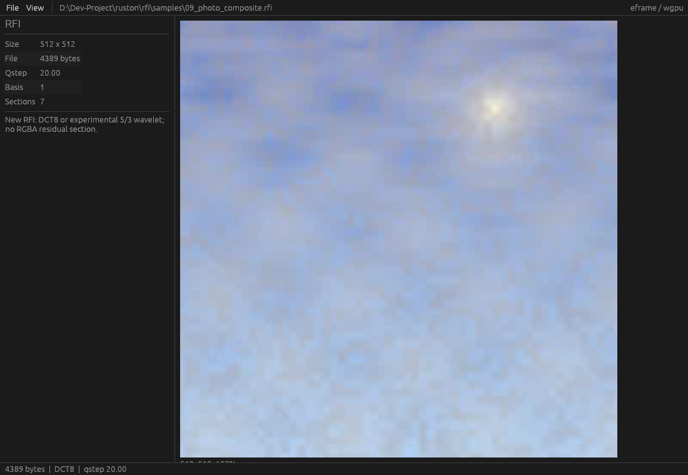

# RFI — RGBA Function Image

RFI is an image format built on mathematical basis expansions. The current
format uses DCT coefficients at multiple frequencies, not an RGBA pixel matrix
and not an RGBA residual section.

The former v1 format has been removed from this project. New RFI uses a new
8-byte signature and rejects old .rfi bytes. There is no compatibility layer.

## New format

- signature: 52 46 49 0D 0A 1A 0A 00 (RFI CR LF EOF LF NUL)
- 96-byte header, 32-byte section entries, no per-tile directory
- separate DC, AC-count, AC-position and AC-value coefficient sections
- per-section entropy backend: zstd, order-0 rANS, or automatic per-section choice
- AC run stream bucketed by previous zigzag position (8 buckets, no side data)
- DCT16 uses 16x16 luma/chroma subband quantization matrices
- per-file selector evaluates basis x backend at each byte budget
- 64x64 tiles, 8x8 DCT basis, YCbCr 4:2:0
- quantized zigzag coefficients, DC prediction, zero-run coding, zstd
- no RGBA residual section
- basis id 1 = DCT8; basis id 3 = DCT16; basis id 2 (wavelet) retired and rejected
- old .rfi signature is rejected by the new parser
- new .rfi signature is rejected by any v1 parser

Normative spec: [specification/frequency-format.md](specification/frequency-format.md).

## Workspace

| crate | role |
|---|---|
| rfi-frequency | new RFI container, DCT encoder/decoder, RD CLI library |
| rfi-cli | new-format CLI: encode, decode, inspect, rd |
| rfi-viewer | egui + eframe + wgpu viewer for new .rfi |

Only these three crates are in the workspace. The old v1 crates were removed.

## Build

~~~
cargo build --workspace --release
cargo test --workspace --release
cargo run -p rfi-cli --release -- encode photo.jpg photo.rfi 20
cargo run -p rfi-cli --release -- decode photo.rfi photo.png
cargo run -p rfi-cli --release -- inspect photo.rfi
cargo run -p rfi-cli --release -- rd photo.jpg reports/rfi-rd
cargo run -p rfi-cli --release -- analyze photo.jpg reports/p0
cargo run -p rfi-viewer --release -- --file photo.rfi
cargo run -p rfi-viewer --release -- --check photo.rfi
cargo run -p rfi-viewer --release -- --file photo.rfi --screenshot reports/viewer.png
~~~

## Rate-distortion

Real 1920x1080 photo, same input and sRGB RGBA8 PSNR for all points:

True serialized-size control, soft luma matrix, Y/Chroma matrices and varint
DC/AC coefficient coding:

| budget | basis | actual bytes | PSNR | SSIM |
|---:|---|---:|---:|---:|
| 25 KB | DCT16+auto | 24,995 | 22.41 dB | 0.7071 |
| 50 KB | DCT16+auto | 49,994 | 24.41 dB | 0.7840 |
| 100 KB | DCT8+auto | 99,997 | 27.23 dB | 0.8730 |
| 200 KB | DCT8+auto | 199,950 | 31.08 dB | 0.9409 |

The new frequency representation materially improves the old RFI 100-765 KB
region, but it is still behind WebP/JPEG at very low rates. The 50 KB point is
20.56 dB, not 50 dB. Full report:
[reports/frequency-rd.md](reports/frequency-rd.md).
P0 coefficient/quality analysis:
[reports/p0-1920/README.md](reports/p0-1920/README.md).
P1 matrix experiment:
[reports/p1-1920/README.md](reports/p1-1920/README.md).
P2 varint entropy:
[reports/p2-1920/README.md](reports/p2-1920/README.md).
P4 no tile directory:
[reports/p4-1920/README.md](reports/p4-1920/README.md).
P4z zstd level 19:
[reports/p4z-1920/README.md](reports/p4z-1920/README.md).
P2split DC/AC sections:
[reports/p2split-1920/README.md](reports/p2split-1920/README.md).
P2run AC run lengths:
[reports/p2run-1920/README.md](reports/p2run-1920/README.md).
P2dc DC/AC bit allocation:
[reports/p2dc-1920/README.md](reports/p2dc-1920/README.md).
P2pv AC position/value split:
[reports/p2pv-1920/README.md](reports/p2pv-1920/README.md).
P2cnt AC count stream:
[reports/p2cnt-1920/README.md](reports/p2cnt-1920/README.md).
P2pack packed AC counts:
[reports/p2pack-1920/README.md](reports/p2pack-1920/README.md).
P2m7 luma matrix 0.7:
[reports/p2m7-1920/README.md](reports/p2m7-1920/README.md).
P2dcc continuous DC prediction:
[reports/p2dcc-1920/README.md](reports/p2dcc-1920/README.md).
P2dcs luma/chroma DC split:
[reports/p2dcs-1920/README.md](reports/p2dcs-1920/README.md).
P6 DCT16 / per-file selection:
[reports/p6dct16-1920/README.md](reports/p6dct16-1920/README.md).
P5 wavelet experiment:
[reports/p5-1920/README.md](reports/p5-1920/README.md).

## Status

Implemented and tested:

- new container, signature, header CRC, section CRCs, old-format rejection
- DCT8/YCoCg 4:2:0 encode/decode
- quantization matrices (separate luma/chroma), JPEG-LS MED DC prediction
- separate DC, AC-count, AC-position and AC-value coefficient streams
- selectable per-section entropy backend: zstd level 19 or order-0 rANS, or automatic per-section choice
- per-file selector evaluates DCT8/DCT16 x (zstd / rANS / auto) at each byte budget
- CLI: encode, decode, inspect, best-rd, rans-rd, dct16-rd, analyze
- viewer with open/drag-drop, fit/zoom, checkerboard, tile grid, metadata,
  headless check and screenshot
- unit tests: DCT8/DCT16 round-trips, rANS round-trip, MED predictor,
  old-magic rejection, header corruption rejection
- workspace build/clippy/tests

Experimental / not implemented:

- alpha channel (current alpha is opaque)
- per-tile basis selection (selection is per file)
- context/banded rANS: implemented and rejected (per-stream table overhead
  exceeded the gain); see reports/x2-1920
- wavelets: implemented (multilevel 5/3 + EZW zerotree), measured 5.1-7.6 dB
  behind DCT, and removed; basis id 2 is now rejected
- codec parity with WebP/JPEG at 100-500 KB
- GPU compute for the new format

The old v1 implementation and its docs/tests are no longer part of the project.

## Experiments

| report | result |
|---|---|
| [P0 coefficient analysis](reports/p0-1920/README.md) | real byte breakdown at 25/50/100/200 KB |
| [P1 matrix](reports/p1-1920/README.md), [P2 varint](reports/p2-1920/README.md), [P2split](reports/p2split-1920/README.md), [P2run](reports/p2run-1920/README.md), [P2dc](reports/p2dc-1920/README.md), [P2pv](reports/p2pv-1920/README.md), [P2cnt](reports/p2cnt-1920/README.md), [P2pack](reports/p2pack-1920/README.md), [P2dcc](reports/p2dcc-1920/README.md), [P2dcs](reports/p2dcs-1920/README.md) | DCT coefficient coding progression, all kept |
| [P4 no tile directory](reports/p4-1920/README.md), [P4z zstd 19](reports/p4z-1920/README.md) | removed directory and raised zstd level, kept |
| [P5 wavelet](reports/p5-1920/README.md), [W6 wavelet + EZW](reports/w6-1920/README.md) | negative: 5.1-7.6 dB behind DCT, code removed |
| [P6 DCT16](reports/p6dct16-1920/README.md) | kept: wins 25/50 KB, selected per file |
| [P7 MED predictor](reports/p7med-1920/README.md) | kept: free predictor gain |
| [P9 Golomb-Rice](reports/p9rice-1920/README.md) | negative, reverted |
| [R4 rANS](reports/r4-1920/README.md) | kept: wins 100/200 KB; per-section auto choice now wins everywhere |
| [X2 banded rANS](reports/x2-1920) | negative, removed |
| [compare-final](reports/compare-final.md) | basis x entropy summary |
| [T1 stronger basis](reports/t1-basis/README.md) | negative: KLT coding gain only +0.21 dB over DCT, -3.2 dB held out |

## License

MIT. See LICENSE.